# Praktikum 4 : CSS Layout - Lab4Web

**Nama**        : Milan Nurwiyadi  
**NIM**         : 312510073  
**Kelas**       : I253B  
**Dosen**       : Sufajar Butsianto, S.Kom, M.Kom.  
**Mata Kuliah** : Pemograman WEB

=================================================================================================
# Langkah - Langkah Praktikum 
1. Membuat dokumen HTML dengan nama file `lab4_box.html` dan buat struktur htmlnya
```
<!DOCTYPE html> 
<html lang="en"> 
<head> 
<meta charset="UTF-8"> 
<meta name="viewport" content="width=device-width, initial-scale=1.0"> 
<title>Box Element</title> 
</head> 
<body> 
<header> 
<h1>Box Element</h1> 
</header> 
</body> 
</html>
```

- Membuat box element dengan tag `<div>`
```
<section> 
<div class="div1">Div 1</div> 
<div class="div2">Div 2</div> 
<div class="div3">Div 3</div> 
</section> 
```
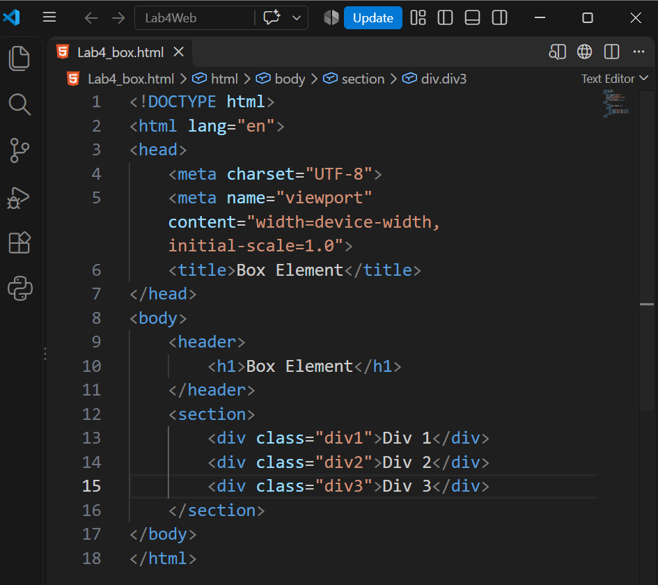
- CSS Float Property   
Menambahkan deklarasi CSS untuk membuat float property,dan berikut hasilnya
```
<style> 
div { 
float:left; 
padding: 10px; 
} 
.div1 { 
background: red; 
} 
.div2 { 
background: yellow; 
} 
.div3 { 
background: green; 
} 
</style>
```
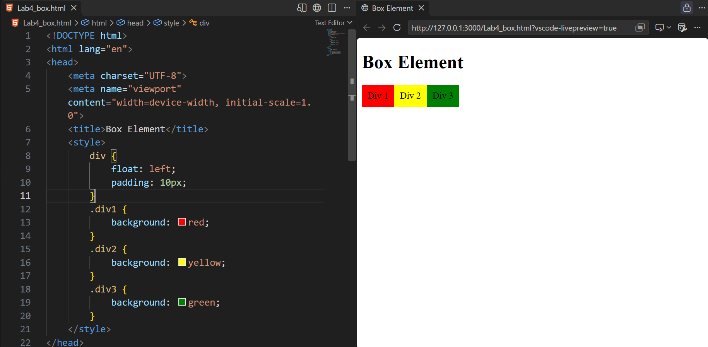

- Mengatur Clearfix Element   
Tambahkan element `<div>` lainnya seteleah `div3` seperti berikut. 
```
<section> 
<div class="div1">Div 1</div> 
<div class="div2">Div 2</div> 
<div class="div3">Div 3</div> 
<div class="div4">Div 4</div> 
</section> 
```
Kemudian atur property clear pada CSS, seperti berikut 
```
.div4 { 
background-color: blue; 
clear: left; 
float: none; 
} 
```
maka hasilnya seperti ini 
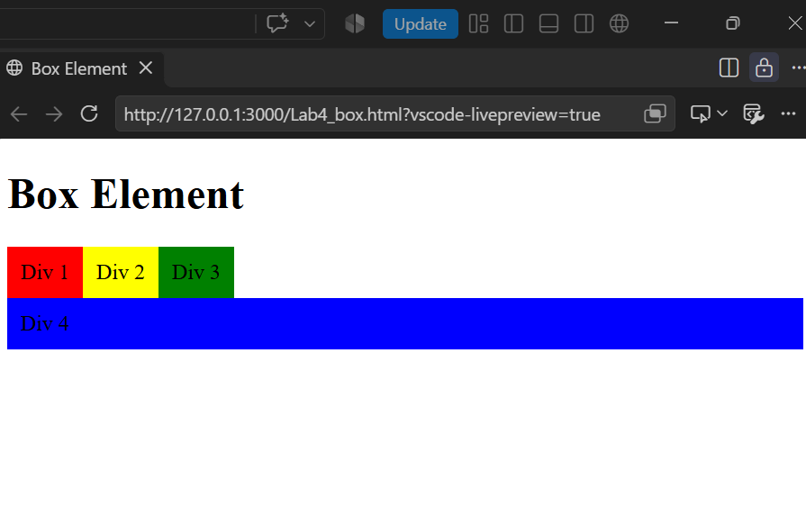

dan ini beberapa percobaan ketika clear nya diubah menjadi (`left, both, right`)  
menggunakan `clear: right; dengan` `float: none;`
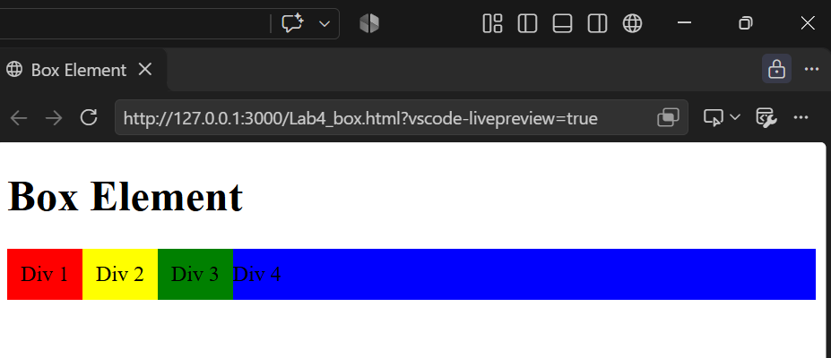
jika menggunakan `clear: right; ``float: right;` 
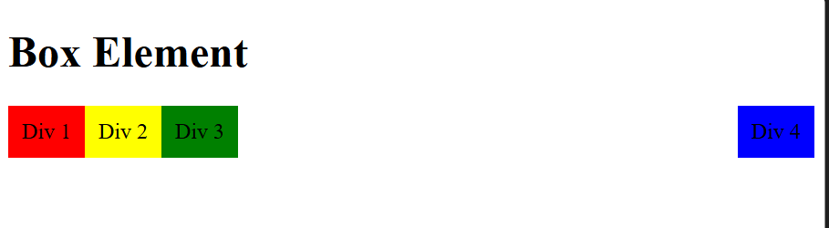
Jika menggunakan `clear: both;``float: right;` 
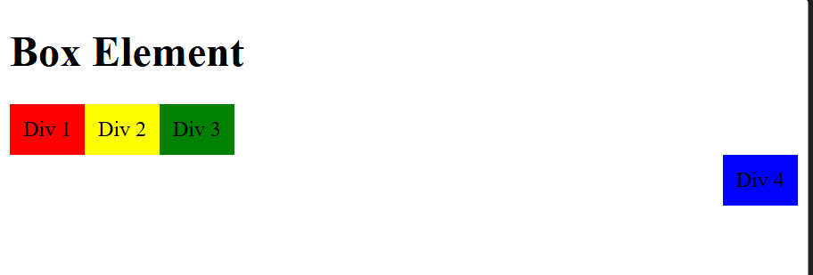
Jika menggunakam `clear: both;``float: left;`
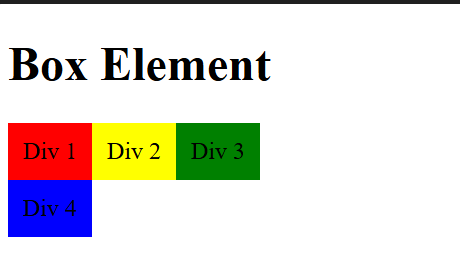

2. Membuat layout sederhana
- Buat folder baru dengan nama `lab4_layout`, kemudian buatlah file baru didalamnya dengan 
nama `home.html`, dan file css dengan nama `style.css`.
- Tulis kode pada `home.html` untuk membuat kerangka layout
```
<!DOCTYPE html>
<html lang="en">
<head>
    <meta charset="UTF-8">
    <meta name="viewport" content="width=device-width, initial-scale=1.0">
    <title>Layout Sederhana</title>
    <link rel="stylesheet" href="style.css">
</head>
<body>
    <div id="container">
        <header>
            <h1>Layout Sederhana</h1>
        </header>
        <nav>
            <a href="home.html" class="active">Home</a>
            <a href="artikel.html">Artikel</a>
            <a href="about.html">About</a>
            <a href ="kontak.html">Kontak</a>
        </nav>
        <section id="hero"></section>
        <section id="wrapper">
            <section id="main"></section>
            <aside id="sidebar"></aside>
        </section>
        <footer>
            <p>%copy; 2026 - Universitas Pelita Bangsa</p>
        </footer>
    </div>
</body>
</html>
```
dan ini hasilnya :
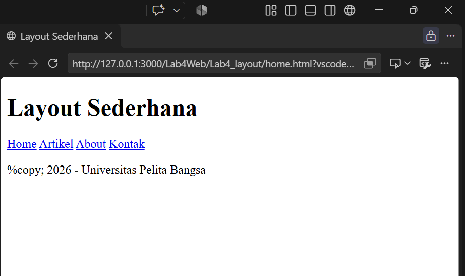

- Tambahkan kode CSS `style.css`untuk membuat layout
```
@import url('https://fonts.googleapis.com/css2?family=Open+Sans:ital,wght@0,300..800;1,300..800&display=swap');

/* Reset CSS */
* {
    margin: 0;
    padding: 0;
}

body {
    line-height: 1;
    font-size: 100%;
    font-family: 'Open Sans', sans-serif;
    color: #5a5a5a;
}

#container {
    width: 980px;
    margin: 0 auto;
    box-shadow: 0 0 1em #cccccc;
}

/* header */
header {
    padding: 20px;
}

header h1 {
    margin: 20px 10px ;
    color: #b5b5b5;
}
```
dan hasilnya seperti ini : 
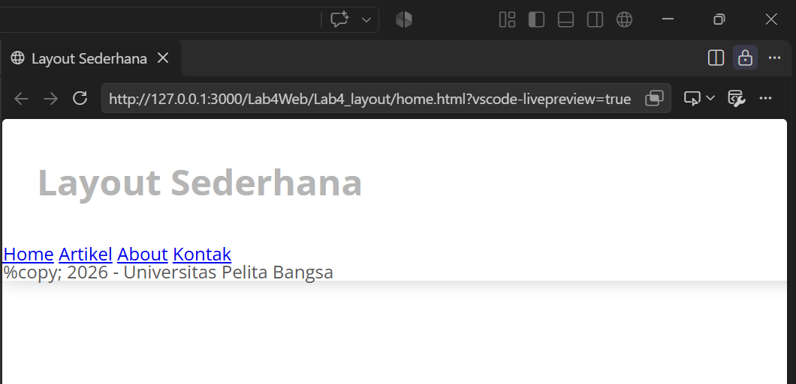

- Kemudian buatkan Navigasi
```
/* Navigasi */
nav {
    display: block;
    background-color: #1f5faa;
}

nav a {
    padding:15px 30px;
    display: inline-block;
    color: #ffffff;
    font-size: 14px;
    text-decoration: none;
    font-weight: bold;
}

nav a.active,
nav a:hover {
    background-color: #2b83ea;
}
```
dan ini hasilnya : 
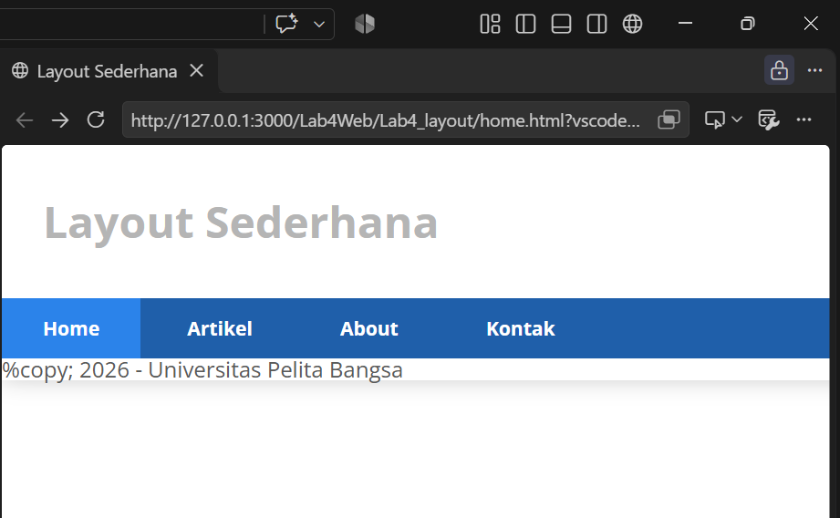

- Membuat Hero Panel
tambahkan kode pada `<section id="hero">`
```
 <section id="hero">
            <h1>Hello Word</h1>
            <p>Lorem ipsum dolor sit amet consectetur adipisicing elit. Fugiat quas, consequatur cum quos nulla corrupti suscipit tenetur minus recusandae fuga quasi impedit dolore repellendus debitis in nam, obcaecati velit nostrum!</p>
            <a href="home.html" class="btn btn-large">Learn more %raquo;</a>
        </section>
```

tambahkan juga kode CSS nya 
```
/* Hero Panel */
#hero {
    background-color: #e4e4e5;
    padding:50px 20px;
    margin-bottom: 20px;
}

#hero h1 {
    margin-bottom: 20px;
    font-size: 35px;
}

#hero p {
    margin-bottom: 20px;
    font-size: 18px;
    line-height: 25px;
}
```
Maka hasil nya akan seperti ini : 
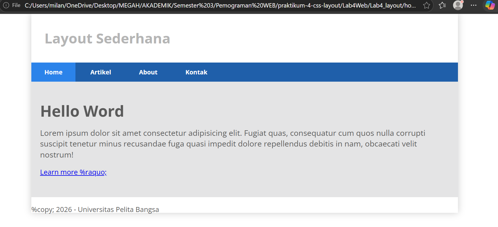

- Mengatur layout main dan sidebar  
Selanjutnya mengatur main content dan sidebar, tambahkan CSS float
```
/* main content */ 
#wrapper { 
margin: 0; 
} 
 
#main { 
float: left; 
width: 640px; 
padding: 20px; 
} 
 
/* sidebar area */ 
#sidebar { 
float: left; 
width: 260px; 
padding: 20px; 
}
```
- Membuat sidebar widget    
Kemudian selanjutnya menambahkan element lain dalam sidebar
```
<aside id="sidebar"> 
    <div class="widget-box"> 
        <h3 class="title">Widget Header</h3> 
        <ul> 
            <li><a href="#">Widget Link</a></li> 
            <li><a href="#">Widget Link</a></li> 
            <li><a href="#">Widget Link</a></li> 
            <li><a href="#">Widget Link</a></li> 
            <li><a href="#">Widget Link</a></li> 
         </ul> 
    </div> 
    <div class="widget-box"> 
        <h3 class="title">Widget Text</h3> 
        <p>Lorem ipsum dolor, sit amet consectetur adipisicing elit. Debitis molestias maiores modi eius, fugit autem reprehenderit neque est mollitia, perferendis sit ullam voluptate natus, hic ad nemo ipsam! Maxime, eligendi.</p> 
    </div> 
</aside>
```
Lalu tambahkan CSS
```
/* widget */
.widget-box {
    border: 1px solid #eee;
    margin-bottom: 20px;
}

.widget-box .title {
    padding: 10px 16px;
    background-color: #428bca;
    color: #ffffff;
}

.widget-box ul {
    list-style-type: none;
}

.widget-box li {
    border-bottom: 1px solid #eee;
}

.widget-box li a {
    padding: 10px 16px;
    color: #333;
    display: block;
    text-decoration: #eee;
}

.widget-box li:hover a {
    background-color: #eee;
}

.widget-box p {
    padding: 15px;
    line-height: 25px;
}
```

dan ini adalah tampilan widget sidebar
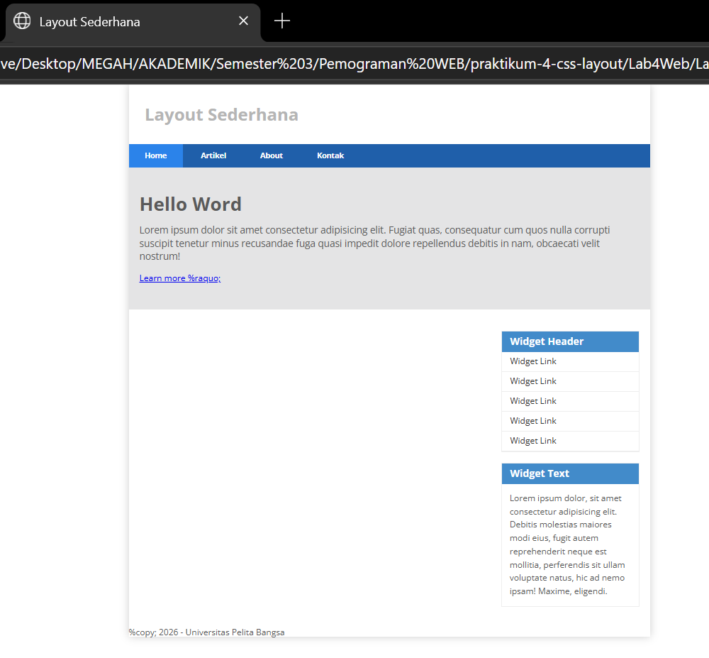

- Mengatur Footer  
Selanjutnya mengatur tampilan footer. Tambahkan CSS untuk footer. 
```
/* footer */
footer {
    clear: both;
    background-color: #1d1d1d;
    padding: 20px;
    color: #eee;
}
```
dan ini tampilan footer 
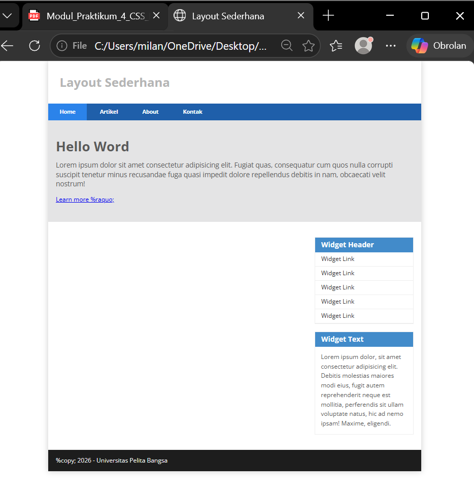

- Menambahkan Elemen lainnya pada Main Content
```
<section id="main"> 
    <div class="row"> 
        <div class="box"> 
             
            <h3>Heading</h3> 
            <p>Donec sed odio dui. Etiam porta sem malesuada magna mollis euismod.</p> 
            <a href="#" class="btn btn-default">View detail</a> 
        </div> 
        <div class="box">
            
            <h3>Heading</h3>
            <p>Donec sed odio dui. Etiam porta sem malesuada magna mollis euismod.</p>
            <a href="#" class="btn btn-default">View detail</a>
        </div>
        <div class="box">
            
            <h3>Heading</h3>
            <p>Donec sed odio dui. Etiam porta sem malesuada magna mollis euismod.</p>
            <a href="#" class="btn btn-default">View detail</a>
        </div>
    </div>
</section>
```
Kemudian tambahkan CSS 
```
/* box */ 
.box { 
    display:block; 
    float:left; 
    width:33.333333%; 
    box-sizing:border-box; -moz-box-sizing:border-box; -webkit-box-sizing:border-box; 
    padding:0 10px; 
    text-align:center; 
} 
 
.box h3 { 
    margin: 15px 0; 
} 
 
.box p { 
    line-height: 20px; 
    font-size: 14px; 
    margin-bottom: 15px; 
} 
 
box img { 
    border: 0; 
    vertical-align: middle; 
} 
 
.image-circle { 
    border-radius: 50%; 
} 
 
.row { 
    margin: 0 -10px; 
    box-sizing: border-box; 
    -moz-box-sizing: border-box; -webkit-box-sizing: border-box; 
} 

.row:after, .row:before,
.entry:after, .entry:before {
    content:'';
    display: table;
}

.row:after,
.entry:after {
    clear:both;
}
```
Dan ini tampilan content nya 
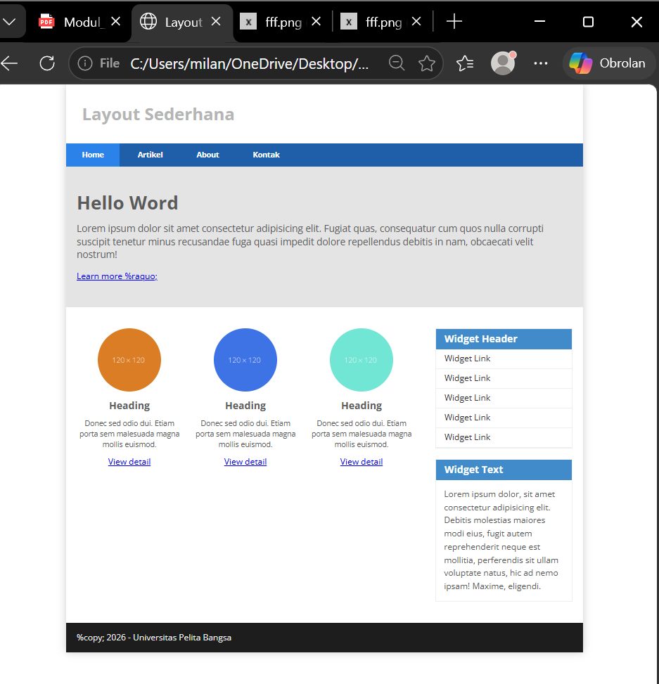

- Menambahkan Content Artikel
Selanjutnya membuat content artikel. Tambahkan HTML berikut pada main content. 
```
<hr class="divider">
<article class="entry">
    <h2>First featurette heading.</h2>
    
    <p>Lorem ipsum dolor sit amet consectetur adipisicing elit. Quia voluptatem quaerat optio inventore, rem distinctio numquam illum, quisquam delectus id et adipisci temporibus ipsum provident veritatis esse, totam reprehenderit perferendis.</p>
</article>
<hr class="divider">
<article class="entry">
    <h2>First featurette heading.</h2>
    
    <p>Lorem ipsum dolor sit amet consectetur adipisicing elit. Quia voluptatem quaerat optio inventore, rem distinctio numquam illum, quisquam delectus id et adipisci temporibus ipsum provident veritatis esse, totam reprehenderit perferendis.</p>
</article>
```
Kemudian tambahkan CSS
```
.divider {
    border: 0;
    border-top: 1px solid #eeeeee;
    margin: 40px 0;
}

/* Entry */

.entry {
    margin: 15px 0;
}

.entry h2 {
    margin-bottom: 20px;
}

.entry p {
    line-height: 25px;
}

.entry img {
    float: left;
    border-radius: 5px;
    margin-right: 15px;
}

.entry .right-img {
    float:right;
}
```
Dan ini tampilan artikelnya 


==============================================================================================

# Pertanyan dan Tugas
1. Menambahkan layout pada about dengan single layout
- buat file baru `about.html` lalu berikut kodenya
```
<!DOCTYPE html>
<html lang="id">
<head>
    <meta charset="UTF-8">
    <meta name="viewport" content="width=device-width, initial-scale=1.0">
    <title>Tentang Saya - Layout Sederhana</title>
    <link rel="stylesheet" href="style.css">
    <style>
        .about-header {
            display: flex;
            align-items: center;
            gap: 30px;
            margin-bottom: 30px;
            background: #f9f9f9;
            padding: 30px;
            border-radius: 8px;
            border-left: 4px solid #1f5faa;
            width: 870px;
        }
        .about-avatar {
            width: 150px;
            height: 150px;
            border-radius: 50%;
            object-fit: cover;
            border: 4px solid #fff;
            box-shadow: 0 4px 10px rgba(0,0,0,0.1);
        }
        .about-bio h2 {
            margin-bottom: 10px;
            color: #333;
        }
        .about-bio p {
            line-height: 26px;
            color: #666;
        }
        .skills-container {
            display: flex;
            flex-wrap: wrap;
            gap: 10px;
            margin-top: 15px;
        }
        .skill-badge {
            background-color: #e2eeff;
            color: #1f5faa;
            padding: 6px 14px;
            border-radius: 20px;
            font-size: 13px;
            font-weight: bold;
        }
        
    </style>
</head>
<body>
    <div id="container">
        <header>
            <h1>Layout Sederhana</h1>
        </header>
        
        <nav>
            <a href="home.html">Home</a>
            <a href="artikel.html">Artikel</a>
            <a href="about.html" class="active">About</a>
            <a href="kontak.html">Kontak</a>
        </nav>

        <section id="wrapper">
            <section id="main" style="width: 100%;">
                <div class="about-header">
                    
                    <div class="about-bio">
                        <h2>Halo, Selamat Datang!</h2>
                        <p>Saya adalah seorang mahasiswa aktif Program Studi Teknik Informatika di Universitas Pelita Bangsa yang memiliki minat besar dalam dunia pengembangan web, antarmuka pengguna (UI), dan sistem digital berbasis web.</p>
                        <div class="skills-container">
                            <span class="skill-badge">HTML5</span>
                            <span class="skill-badge">CSS3</span>
                            <span class="skill-badge">JavaScript</span>
                            <span class="skill-badge">Git & GitHub</span>
                        </div>
                    </div>
                </div>               
            </section>
        </section>

        <footer>
            <p>&copy; 2026 - Universitas Pelita Bangsa</p>
        </footer>
    </div>
</body>
</html>
```
berikut gambar layout about:  

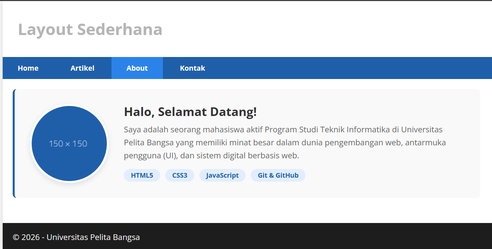

2. Menambahkan layout pada kontak dengan single layout
- buat file baru `kontak.html` lalu berikut kodenya 
```
<!DOCTYPE html>
<html lang="id">
<head>
    <meta charset="UTF-8">
    <meta name="viewport" content="width=device-width, initial-scale=1.0">
    <title>Layout Sederhana - Kontak</title>
    <link rel="stylesheet" href="style.css">
    <style>
        #main h2{
            margin-bottom: 10px;
        }

        .contact-form {
            padding: 20px 0; 
        }

        .form-group { 
            margin-bottom: 15px; 
        }

        .form-group label { 
            display: block; margin-bottom: 5px; font-weight: bold; 
        }

        .form-group input, .form-group textarea {
            width: 100%; 
            padding: 10px; 
            border: 1px solid #ccc; 
            border-radius: 4px; 
            box-sizing: border-box;
            width: 900px;
        }

        .btn-submit { 
            background-color: #1f5faa; 
            color: white; 
            padding: 10px 20px; 
            border: none; 
            border-radius: 4px; 
            cursor: pointer; 
        }

        .btn-submit:hover { 
            background-color: #2b83ea; 
        }
    </style>
</head>
<body>
    <div id="container">
        <header>
            <h1>Layout Sederhana</h1>
        </header>
        
        <nav>
            <a href="home.html">Home</a>
            <a href="artikel.html">Artikel</a>
            <a href="about.html">About</a>
            <a href="kontak.html" class="active">Kontak</a>
        </nav>

        <section id="wrapper">
            <section id="main" style="width: 100%;">
                <h2>Hubungi Kami</h2>
                <p>Silakan isi formulir di bawah ini untuk mengirimkan pesan atau pertanyaan kepada kami.</p>
                
                <div class="contact-form">
                    <form action="#" method="post">
                        <div class="form-group">
                            <label for="nama">Nama Lengkap:</label>
                            <input type="text" id="nama" name="nama" placeholder="Masukkan nama Anda..." required>
                        </div>
                        <div class="form-group">
                            <label for="email">Email:</label>
                            <input type="email" id="email" name="email" placeholder="Masukkan email Anda..." required>
                        </div>
                        <div class="form-group">
                            <label for="pesan">Pesan:</label>
                            <textarea id="pesan" name="pesan" rows="5" placeholder="Tuliskan pesan Anda di sini..." required></textarea>
                        </div>
                        <button type="submit" class="btn-submit">Kirim Pesan</button>
                    </form>
                </div>
            </section>
        </section>

        <footer>
            <p>&copy; 2026 - Universitas Pelita Bangsa</p>
        </footer>
    </div>
</body>
</html>
```
berikut gambar layout kontak : 

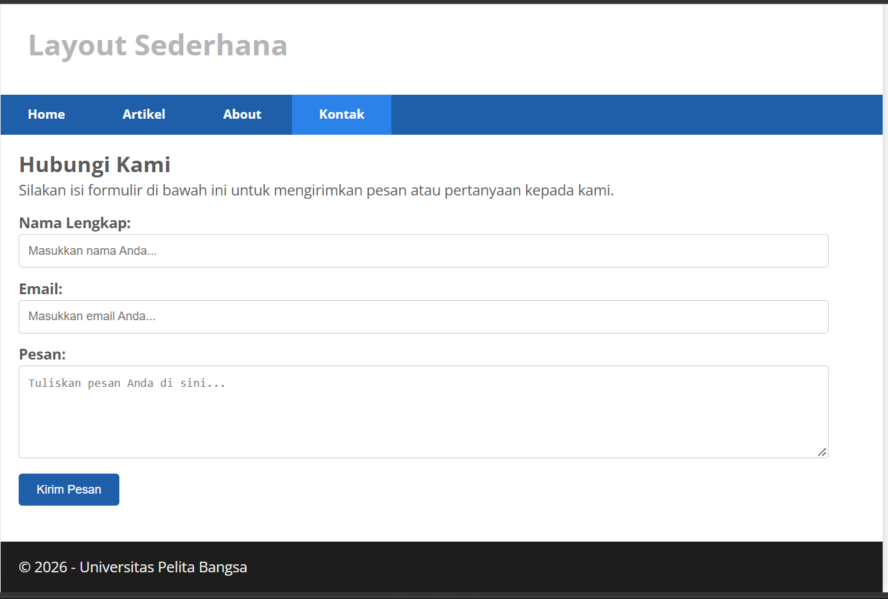